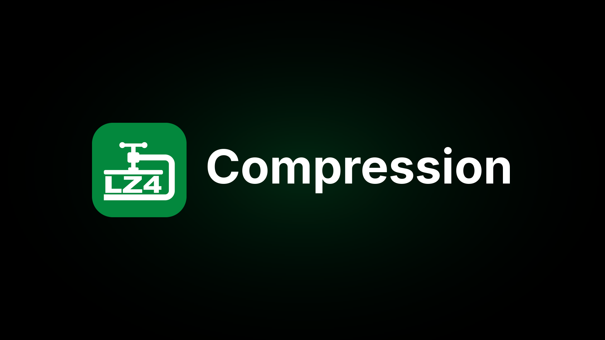

# LZ4 Compression for PS5

[](https://buymeacoffee.com/theghostonline) [](https://discord.gg/AgBSm7JqjS)



Shrink your PS5 games on the console itself. Pick a game, choose
`Compress with LZ4`, and it packs the game data into LZ4 asset packs that
APR-EMU reads while the game runs. Every file gets checked before anything's
deleted, and if the game doesn't ship APR-EMU, the right runtime is added for
you.

It also does everything around that: `.ffpfsc` compression, exFAT/PFS images,
validate and repair, APR-EMU versions, copy and move, and a history of every
job.

## What works

- LZ4 asset packs for any game that uses AMPR (most PS5 games), with a check of
  every block before the original goes
- `.ffpfsc` compression for everything else, with an exFAT or PFS image inside
- Validate, and repair broken PFSC blocks where it can
- Uncompress back to a normal folder, in place or as a copy
- Build or refresh `ampr_emu.index`, pick an APR-EMU version, set images read-only
- Copy and move games between internal storage and USB drives
- Progress, speed, time left and a history of every job
- Jobs keep running on the console if you close the app or the browser

The packs match drakmor's `ampr_pack.py` byte for byte, and everything above was
checked on a 13.60 console.

## How it works

- **The app** (`LZ4 Compression`, `PPSA99420`): a native app, no browser. Your
  library runs left to right like the home screen, every game has its own page,
  and Circle goes back.
- **The engine** (`lz4-compression.elf`): the payload that does the work. It
  serves the app and a web page on port `5920` and keeps its settings, caches
  and logs in `/data/LZ4Compression`. The app starts it through Payload Manager
  when it isn't running.
- **The web page** at `http://<PS5 IP>:5920` does the same from a PC or phone,
  and it's where you upload TOML profiles from another device.

When you pack a game it builds `ampr_emu.index`, works out what to pack (game
data goes in, while executables, PRX/SPRX, `sce_sys`, `sce_module`, `fakelib`,
saves, configs and already-compressed media stay loose), compresses every block
with LZ4 on all CPU cores, writes the packs and their CRC sidecars, checks every
packed file against the original, and installs the pack-capable APR-EMU runtime
into `fakelib/libSceAmpr.sprx`.

It doesn't share a tile, port or settings folder with Game Compressor, so you
can have both installed.

## Requirements

- A jailbroken PS5 that runs payload ELFs
- [ShadowMountPlus](https://github.com/drakmor/ShadowMountPlus), latest version
- [kstuff-lite](https://github.com/EchoStretch/kstuff-lite) 1.07 or later
- [Payload Manager](https://github.com/itsPLK/ps5-payload-manager), or another
  way to load `lz4-compression.elf`

Tested on 13.60 with kstuff-lite 1.11 and ShadowMountPlus 1.7.

## Install

1. Download `lz4-compression.elf` and `LZ4-Compression-PPSA99420.zip` from the
   [latest release](https://theghostonline.dev/theghostonline/PS5-LZ4-Compression/releases/latest).
2. Upload `lz4-compression.elf` in Payload Manager. Version 0.6 keeps it in
   `/data/pldmgr/payloads/local/lz4-compression/`, older ones in
   `/data/pldmgr/payloads/lz4-compression/`. The app starts it from either.
3. Unzip the app and copy the `PPSA99420` folder to `/data/homebrew/PPSA99420`
   over FTP. ShadowMount+ adds the `LZ4 Compression` tile. It doesn't scan while
   a game's running, so close any game if the tile doesn't show up.
4. Open the tile. If the engine isn't running, the app starts it.

You can skip the app too: load the ELF and open `http://<PS5 IP>:5920` in any
browser.

**Updating:** the app checks for a new version when it opens and updates
itself, engine included. 1.5.0's updater still checks the old GitHub page, so
from 1.5.0 update by hand this once (same steps as above, replacing both files).

## Using it

1. Open a game from the library. The main button is what you'll want most of the
   time:
   - Games that use AMPR show `Compress with LZ4`
   - Other games show `Compress` (`.ffpfsc`)
   - 007 First Light and HITMAN 3 show `Compress` too. They read their `.rpkg`
     files straight from disk, so they can't run from LZ4 packs
   - Compressed games show `Validate and Repair`
   - LZ4 packed games show `Verify LZ4 Packs`
   - Folders that won't boot can use `Verify Game Files` under Check
2. Everything else is under Options, grouped as Compress, Check, Restore,
   APR-EMU, Copy and move, and Delete.
3. History in the top bar shows every job. The home screen shows the latest.
4. Packed games show how they run for other people. `Report how it runs` gives
   you a QR code for your phone that opens a filled-in game report here.

**LZ4 settings**
- **Level:** 1 to 12, the same scale as Lazy_AMPR. 1 to 4 are fast, 5 to 12 are
  LZ4 HC. 9 is the default, 12 is the smallest and slowest.
- **Profile:** `Automatic` picks one for you. The bundled community profiles in
  [`profiles/`](profiles/) (ASTRO BOT, EA Sports UFC 6, Insomniac and Unity
  engine games) match by title ID, name or file layout, and everything else
  gets a scan-based profile. `Custom or Trace Config` uses your own `ampr_pack`
  TOML: put it in `/data/LZ4Compression/import` or on a USB drive and use
  Import config, or upload it from the web page. Your own config always wins.
- **Destination:** next to the game, internal SSD or external storage. The
  output is a folder called `<name>-lz4`.
- **Original:** `Keep original` leaves it alone. `Delete after verified` removes
  it once everything's been checked. `Pack in place` (folders only) needs the
  least free space and puts the folder back exactly as it was if anything fails
  before the originals are removed.

`Uncompress LZ4` gives you the loose game back. While a game's packed, the
APR-EMU options are locked, because the packs only work with that exact index
and runtime. The original APR-EMU file is backed up first and comes back when you
uncompress in place.

**.ffpfsc settings:** exFAT inside is the default and the one to use, PFS is
experimental. `Delete after verified` keeps the original until the output's
been validated. `Destructive` deletes as it goes, needs 1 GB free, can't be
cancelled once it starts, and only works for folders on the same drive.

**When you're done,** press the power button in the top bar and pick
`Stop engine and close`, so it isn't taking anything away from your games.

## Troubleshooting

- **A game doesn't show up.** The library only lists games. Anything under
  2 GB counts as an app and gets left out. It scans `/data/homebrew`,
  `/data/etaHEN/games`, `/mnt/ext0`, `/mnt/ext1` and `/mnt/usb0` to `/mnt/usb7`
  (plus their `homebrew` and `etaHEN/games` folders).
- **A compressed APR-EMU game stutters from internal SSD.** Open it, go to
  Options, `Uncompress`, and pick `exFAT`. The read-only settings and
  `ampr_emu.index` are already in place.
- **An exFAT image with no `ampr_emu.index`.** Run the game once from USB
  without read-only settings so APR-EMU can make its index, check it starts,
  then copy it to internal SSD and use `Set Read Only`.
- **Rest mode.** Normal jobs carry on after the console wakes up, if the
  payload survives. During deleting, destructive compression, repair and mount
  changes it keeps the console awake until that part's done. If the payload
  stops anyway, the job shows as interrupted in History. Nothing restarts by
  itself, so check the source and output before trying again.
- **Results vary by game.** A trace-based profile is more reliable than the
  automatic one. Keep a backup and launch the game before you delete the
  original.
- **A game won't boot from a plain folder.** Open it and use `Verify Game
  Files`. It fixes the APR-EMU runtime name, the PlayGo stub, an out-of-date
  `ampr_emu.index` and file permissions.
- **Something went wrong.** [Open an issue](https://theghostonline.dev/theghostonline/PS5-LZ4-Compression/issues)
  with the game, its title ID and your firmware.

## Building

The engine needs [ps5-payload-sdk v0.43](https://github.com/ps5-payload-dev/sdk/releases/tag/v0.43)
or newer (its CRT has the 13.60 case, and the build refuses an SDK without it),
plus make, Python 3, Clang 18 and LLD 18:

```sh
export PS5_PAYLOAD_SDK=/path/to/ps5-payload-sdk
make
```

You get `lz4-compression.elf`. zlib 1.3.1, LZ4 1.10.0 and the pinned APR-EMU
PackedStdio runtime are included under `third_party/`.

The app is built with [PS5 React](https://github.com/half144/ps5-react) on a
Mac (Apple silicon):

```sh
git clone https://github.com/half144/ps5-react.git && cd ps5-react
python3 -m venv .venv && .venv/bin/pip install -r requirements.txt && npm ci
brew install cmake sdl2 llvm@18 curl libarchive
PATH="$PWD/.venv/bin:$PATH" npm run build -- --app-dir ../PS5-LZ4-Compression/app/lz4-compression  # dist/PPSA99420
```

Keep LLVM 18 out of `PATH` (the build finds it by itself), because the host tools
need Apple's clang.

## Support

Donations go to this project, not to the projects it builds on. If it saved you space on your PS5, you can buy me a coffee.

<a href="https://buymeacoffee.com/theghostonline"></a>

Can't donate? A star or a bug report with the game, title ID and firmware helps too.
Every release gets posted on Discord, and it's the quickest place to get help: [#lz4-compression](https://discord.gg/AgBSm7JqjS).

## Credits

LZ4 Compression is built on [PS5 Game Compressor](https://github.com/juma-sayeh/PS5-Game-Compressor)
by Juma Sayeh, with firmware 13.60 and ShadowMountPlus 1.7 support by gcoding97
and Krenar, and its LZ4 side follows [Lazy_AMPR](https://github.com/Nazky/Lazy_AMPR)
by Nazky, Deckerr97, Pippo, Drakmor and williamtcastro. Packed games are read
by Drakmor's [ampr_emu](https://github.com/drakmor/ampr_emu). The APR-EMU
version picker uses Pippo's public APR-EMU manifest and binary mirror
(`pippo26442999`). Third-party components and their licenses are listed in
[THIRD_PARTY_NOTICES.md](THIRD_PARTY_NOTICES.md), and the original copyright
notices are kept in the source files.

## License

The LZ4 packer (`src/ampr_pack*.c`, `src/ampr_pack*.h`, a port of Drakmor's
GPL-3.0 `ampr_pack.py`) and the PS5 app (`app/lz4-compression`, built on the
GPL PS5 React) are licensed under the GNU GPL v3 or later, see [LICENSE](LICENSE).
Code that comes from PS5 Game Compressor stays under its authors' terms.

## Disclaimer

Homebrew for experimental PS5 workflows, so use it at your own risk. Not
affiliated with Sony, PlayStation or any game publisher. To be used with your
own game dumps.
